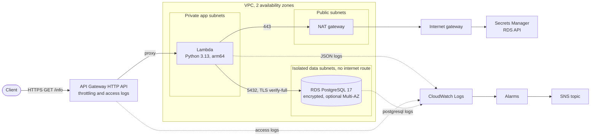

# GET /info on AWS: API Gateway, Lambda and PostgreSQL in a VPC

A Terraform deployment of the NaN Labs Cloud Infrastructure Engineer Challenge
(the original statement is kept in [docs/challenge.md](docs/challenge.md)).

`GET /info` calls a Lambda function that runs in a private subnet, connects to a
PostgreSQL RDS instance in an isolated subnet over verified TLS, and returns the
connection status plus details about the database.



## Status

| What | State |
| ---- | ----- |
| Terraform: format, validate, tflint, checkov | passes, run by `make check` |
| Terraform tests (mocked AWS, no account needed) | passes: 82 test runs, 72 in the modules and the state bootstrap and 5 root tests for each of dev and prod |
| Lambda: lint, 44 unit tests, 7 integration tests against PostgreSQL 17 | passes |
| Local run of the real handler against PostgreSQL 17 | answers 200 with the database details |
| CI workflow on GitHub | passes: all five jobs (Lambda function, Terraform, Lint, Security, Generated docs), first run on the pull request that added it |
| **Deployed to AWS, live endpoint and CloudWatch logs** | **verified**: 68 resources applied, `GET /info` answered 200 on cold and warm calls (`52.4 ms` -> `1.6 ms`), logs and saved queries verified in CloudWatch, then destroyed from the workflow. Evidence: [docs/evidence/dev-us-east-1.md](docs/evidence/dev-us-east-1.md) |

Everything above the last row is verified without AWS. The live deployment was
run in `us-east-1` and then torn down so the NAT gateway and the database do not
keep billing; the steps and a short-lived deployment's cost are below. Details
that were not exercised in that run are listed in [Not verified](#not-verified).

## What it deploys

| Layer | Resource | Notes |
| ----- | -------- | ----- |
| Entry | API Gateway HTTP API, one route `GET /info` | Throttled, JSON access logs, public by design |
| Compute | Lambda, Python 3.13 on arm64, in the private app subnets | JSON logs, least-privilege role, concurrency cap in prod |
| Data | RDS PostgreSQL 17 in isolated data subnets | Encrypted, private, TLS only, automated backups, optional Multi-AZ |
| Network | VPC, 3 subnet tiers in 2 zones, internet gateway, NAT gateway(s), flow logs | One shared NAT in dev, one per zone in prod |
| Security | Security groups with one rule per connection, 2 KMS keys | The database accepts only the Lambda's security group |
| Secrets | RDS-managed master password in Secrets Manager | Rotated by RDS every 7 days; never in code or state |
| Monitoring | 9 CloudWatch alarms (one more per extra NAT gateway), encrypted SNS topic, 3 saved Logs Insights queries | Optional email subscription |

## Requirements checklist

| Requirement | Where |
| ----------- | ----- |
| API Gateway with a single `GET /info` endpoint | [terraform/modules/api](terraform/modules/api) |
| Lambda triggered by the API Gateway | [terraform/modules/lambda](terraform/modules/lambda), invoke permission scoped to that route |
| Database or backend in a private subnet | [terraform/modules/database](terraform/modules/database), data subnets have no internet route |
| Lambda connects and returns status and metadata | [functions/info](functions/info) |
| Lambda logs in CloudWatch | managed log group with retention and encryption |
| VPC, public and private subnets, security groups | [terraform/modules/network](terraform/modules/network), [terraform/modules/security](terraform/modules/security) |
| Lambda in a private subnet using a NAT gateway in a public subnet | the app subnets route `0.0.0.0/0` to the NAT gateway |
| Modular, documented, secure | 7 modules, a README per module, [docs/](docs/) |
| IaC tool with justification | [Why Terraform](#why-terraform) |
| High availability | `db_multi_az`, a NAT gateway per zone, storage autoscaling (prod profile) |
| Backups and recovery | automated backups with point-in-time restore (14 days in prod), final snapshot, tags copied to snapshots |
| GitHub Actions validation | [.github/workflows/ci.yml](.github/workflows/ci.yml) |
| Pre-commit hooks | [.pre-commit-config.yaml](.pre-commit-config.yaml) |
| CloudWatch alarms | [terraform/modules/monitoring](terraform/modules/monitoring) |
| Docker for local testing | [local/](local/) |
| Load balancer or CloudFront | not included, see [Limitations](#limitations) |

## Deploy

First time, or handing this to someone else? [docs/runbook.md](docs/runbook.md) goes
from getting AWS credentials to a working endpoint and back to an empty account,
with both `make` and the GitHub workflow. What follows is the short version.

You need an AWS account you can create resources in. Nothing here uses the VPN or
any other organisation's infrastructure.

Prerequisites: Terraform 1.11 or newer (developed on 1.15.9), [uv](https://docs.astral.sh/uv/)
(it fetches Python 3.13 for the build), AWS credentials in your environment, and
the AWS CLI for `make logs`.

```bash
# 1. Remote state: a bucket with versioning, encryption and no public access.
#    The name must be globally unique. Review the plan, then apply it.
make bootstrap-plan BUCKET=<globally-unique-name>
make bootstrap-apply                 # from here on make finds the bucket by itself

# 2. Optional: edit terraform/environments/dev/terraform.tfvars
#    - allowed_account_ids = ["<AWS_ACCOUNT_ID>"]   stops a wrong profile
#    - alert_email         = "you@example.com"      confirm the email AWS sends

# 3. Plan, review, apply. ENV is dev or prod; REGION defaults to us-east-1.
make plan ENV=dev REGION=us-east-1   # connects to the shared state, builds, saves the plan
make apply ENV=dev REGION=us-east-1  # applies exactly that plan

# 4. Check it.
make verify ENV=dev REGION=us-east-1 # curl the endpoint and print the JSON
make logs ENV=dev REGION=us-east-1   # tail the Lambda's CloudWatch logs

# 5. Tear it down when finished: the NAT gateway and database bill by the hour.
make destroy ENV=dev REGION=us-east-1 CONFIRM=dev
```

Each environment and region has its own state, `info-api-extended/<env>/<region>/terraform.tfstate`.
If a run is interrupted and the state stays locked, Terraform prints a lock ID:
`make unlock ENV=dev REGION=us-east-1 CONFIRM=dev LOCK_ID=<id>`.

**Prefer the GitHub UI to `make`?** The `deploy` workflow does plan, apply, destroy
and unlock from the Actions tab, choosing the environment and region, with the
credentials kept as GitHub secrets. It calls the same targets, so it works on the
same state. Setup is in [docs/github-actions.md](docs/github-actions.md).

The first `apply` creates a NAT gateway and an RDS instance, which usually takes
several minutes (RDS is the slow part). `make apply` refuses to run without a
plan saved by `make plan`, so nothing is applied that was not reviewed.

The state bucket survives `destroy` on purpose (`prevent_destroy`). Remove it by
hand once no environment uses it.

A successful `make verify` prints:

```json
{
  "status": "ok",
  "database": {
    "connected": true,
    "engine": "postgres",
    "version": "17.x",
    "tls": true,
    "latency_ms": 4.2
  },
  "instance": {
    "class": "db.t4g.micro",
    "multi_az": false,
    "availability_zone": "us-east-1a"
  }
}
```

(abridged; the full body is in [functions/info/README.md](functions/info/README.md)).
If the database cannot be reached the API answers `503` with a one-word reason
and nothing else; see [docs/operations.md](docs/operations.md) for what each
reason means.

## Environments

Both are the same code with different settings in `terraform/environments/<env>/`.

| Setting | dev | prod |
| ------- | --- | ---- |
| NAT gateways | one shared | one per zone |
| Database standby (Multi-AZ) | no | yes |
| Automated backups | 7 days | 14 days |
| Deletion protection and final snapshot | off, so it can be torn down | on |
| Lambda concurrency cap | none (small accounts cannot reserve any) | 10 |
| API rate limit (burst) | 5 requests/s (10) | 20 requests/s (40) |
| Log retention | 7 days | 30 days |

`dev` is the one meant to be deployed for evaluation. `prod` shows the high
availability profile and is tested exactly as shipped, but not deployed here.

## Why Terraform

The challenge prefers it, and it fits: the plan is a reviewable diff of what will
change, the AWS provider is mature, `terraform test` can mock AWS so the
configuration is tested without an account, and the linting and scanning tools
(tflint, checkov, terraform-docs) are built around it. CloudFormation, SAM and
CDK tie the work to AWS and make the plan harder to review; Pulumi has a smaller
ecosystem of checks. OpenTofu would probably work unchanged but was not tested.
The full reasoning, with the other decisions, is in [docs/decisions.md](docs/decisions.md).

One root module wires seven small modules together, so a reviewer runs one
`init` and one `apply`, while each module still has one job and its own tests.
Environment settings live outside the code, and the state location is supplied at
`init`, so the same code deploys to any account.

## Security

- **Network.** The database is in subnets with no route to the internet and
  accepts connections only from the Lambda's security group, on one port. The
  default security group has no rules.
- **Secrets.** RDS generates and rotates the master password. It is stored in
  Secrets Manager under a customer-managed key and read by the Lambda at run time.
  No password exists in code, variables or Terraform state.
- **Transport.** TLS is required by the database (`rds.force_ssl`) and verified by
  the Lambda against the RDS certificate bundle, including the hostname.
- **IAM.** The Lambda role can write its own log group, manage network interfaces
  (AWS allows no narrower scope), read one secret, decrypt with one key only when
  the request comes through Secrets Manager, and describe one database instance.
- **Errors reveal nothing.** Failure responses carry a category only; hosts, users
  and exception text go to the logs.
- **Encryption.** Database storage, backups, the secret, every log group
  Terraform creates and the alert topic are encrypted with customer-managed keys
  that rotate. (RDS enhanced monitoring writes to a log group RDS creates itself,
  which uses the default encryption.)
- **Supply chain.** Provider versions are locked with hashes, Python dependencies
  are locked with hashes, workflow actions are pinned to commit SHAs, and the
  database image is pinned by digest. Dependabot proposes updates.

The public endpoint has no authorizer, because the challenge asks for a working
public endpoint and the response is not sensitive. [docs/security.md](docs/security.md)
has the threat analysis and every accepted risk.

## Availability, backup and recovery

- **Multi-AZ.** With `db_multi_az` the database keeps a synchronous standby in
  another zone and fails over automatically. The Lambda uses subnets in two
  zones, and prod has a NAT gateway per zone, so a zone failing does not cut
  egress for the other.
- **Backups.** Automated daily backups with point-in-time restore, tags copied to
  snapshots, and a final snapshot with a unique name when an instance with
  protection enabled is deleted.
- **Scaling.** Lambda scales with requests. Database storage grows automatically
  up to a ceiling. A concurrency cap and API throttling keep a slow database from
  being flooded with connections; the arithmetic is in [docs/architecture.md](docs/architecture.md).
- **Recovery.** Restore steps are in [docs/operations.md](docs/operations.md).

## Monitoring and logging

Lambda and API Gateway write JSON logs to CloudWatch with a retention period and
encryption. Alarms (database CPU, storage, memory and connections; Lambda errors,
throttles and p99 duration; API 5xx; NAT port exhaustion, one per NAT gateway)
notify an SNS topic on alarm and on recovery. Three Logs Insights queries are
saved for the common questions. The alarm table is in
[terraform/modules/monitoring](terraform/modules/monitoring).

## Testing

```bash
make check                  # format, validate, tflint, actionlint, checkov, all tests, ruff
make test                   # Terraform tests only: every module, then the root for dev and prod
make function-test          # Lambda unit tests
make docs                   # regenerate the Terraform README tables (needs terraform-docs 0.24.0)
make local-up && make local-invoke   # run the real handler against a local PostgreSQL 17
```

The Terraform tests use a mocked AWS provider, so they need no account. Beyond
checking each module, a root test applies the whole stack against the mock for
each environment's real settings. It already caught a bug the module tests could
not: alarms keyed by NAT gateway IDs, which only exist after apply, would have
failed the first real deployment.

Pre-commit runs the fast checks on every commit (`pre-commit install`). The
slower ones run before a PR with `pre-commit run --all-files --hook-stage manual`.

For local database testing without an AWS account, `make local-up` starts a
disposable PostgreSQL 17 container (`local/docker-compose.yml`, listening on
`127.0.0.1:5432` with data in `tmpfs` and `local/.env` copied from
`local/.env.example`), `make local-invoke` runs the real handler against it,
`set -a; . local/.env; set +a; make function-integration` runs the integration
suite, and `make local-down` tears it down.

## Not verified

The `dev` deployment ([docs/evidence/dev-us-east-1.md](docs/evidence/dev-us-east-1.md))
confirmed the live endpoint, cold and warm connection reuse, TLS verification
against a real RDS certificate, the `$default` stage invoke permission, all four
encrypted log groups (Lambda, API access, RDS PostgreSQL, VPC Flow Logs), the
three saved Logs Insights queries, and the workflow's `plan` and `destroy`
actions through OIDC. These remain unexercised:

- Creating the state bucket through `terraform/bootstrap` (the run reused an
  existing S3 bucket via `STATE_BUCKET`).
- That alarms can publish to the encrypted topic when a threshold is breached
  (all 9 alarms stayed in `OK`).
- The workflow's `apply` and `unlock` actions, its access-key path, `prod`, and
  regions other than `us-east-1`.
- Prices in [docs/cost.md](docs/cost.md), which are approximate.

## Limitations

- **No load balancer or CloudFront.** The challenge lists them as optional. An HTTP
  API cannot use AWS WAF, so adding WAF would mean CloudFront in front, and the
  direct API address would still need closing. Not done.
- **Single region.** No cross-region backup copy or failover.
- **One public route without authentication.** See [Security](#security).
- **A NAT gateway is the largest cost** of the dev profile, and a shared one is a
  single point of failure for the app subnets' outbound access. VPC endpoints for
  Secrets Manager and the RDS API would remove the dependency and let the
  security group be narrowed; they were left out to keep to the NAT gateway the
  challenge asks for.
- **RDS Proxy is not used.** The concurrency cap bounds connections well enough at
  this scale; the numbers are in [docs/architecture.md](docs/architecture.md).

## Repository layout

```text
terraform/
  bootstrap/      state bucket, run once, local state
  modules/        network, kms, security, database, lambda, api, monitoring
  environments/   dev and prod settings and backend templates
  tests/          root tests, run once per environment
functions/info/   the Lambda: source, tests, sample event, local invoker
local/            Docker Compose for a local PostgreSQL
docs/             architecture, decisions, operations, security, cost
.github/          CI workflow and Dependabot
Makefile          the single entry point for every task
```

## Documentation

- [docs/architecture.md](docs/architecture.md): network plan, access matrix, request
  flow, capacity and failure modes
- [docs/decisions.md](docs/decisions.md): the decisions and what was rejected
- [docs/operations.md](docs/operations.md): deploy, verify, restore, rotate, tear down,
  troubleshoot
- [docs/security.md](docs/security.md): threat analysis and accepted risks
- [docs/cost.md](docs/cost.md): what it costs to run
- Each module has a README, and `functions/info/README.md` describes the function.
