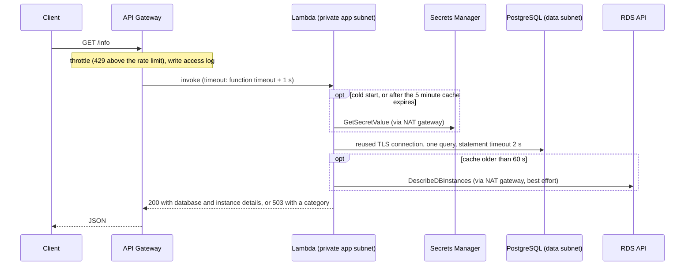

# Architecture

How the pieces fit, what each is allowed to do, and what happens when something
goes wrong. Numbers marked *inferred* are derived, not measured, and are listed
under [Not verified](../README.md#not-verified) in the README where they depend
on real AWS behaviour.

## Request flow

## Network plan

One VPC (`10.20.0.0/16` by default) with three tiers, each a `/24` per zone,
computed with `cidrsubnet`. The offsets (0, 10, 20) leave room for a third zone.

| Tier | Holds | Zone a | Zone b | Default route |
| ---- | ----- | ------ | ------ | ------------- |
| public | NAT gateways | 10.20.0.0/24 | 10.20.1.0/24 | internet gateway |
| app | Lambda network interfaces | 10.20.10.0/24 | 10.20.11.0/24 | NAT gateway in the same zone (`per_az`) or the shared one |
| data | the database | 10.20.20.0/24 | 10.20.21.0/24 | none |

The data tier's route table has only the local VPC route, so the database cannot
reach, or be reached from, the internet. The Lambda reaches Secrets Manager and
the RDS API through the NAT gateway.

## Access matrix

Every connection that is allowed, and nothing else (see
[terraform/modules/security](../terraform/modules/security)):

| From | To | Port | Why |
| ---- | -- | ---- | --- |
| Lambda security group | database security group | 5432 | the query |
| Lambda security group | `0.0.0.0/0` | 443 | Secrets Manager and the RDS API via the NAT gateway |
| database security group | nothing | | replies to allowed connections need no rule |

The only ingress rule in the whole stack is the database's, from the Lambda's
group. Callers reach the Lambda through API Gateway, not the network.

## Permissions of the Lambda role

| Action | Resource | Condition |
| ------ | -------- | --------- |
| write log events | its own log group | |
| create, describe and delete network interfaces and describe subnets | `*` | AWS supports no narrower scope for these |
| `secretsmanager:GetSecretValue` | the database master secret | |
| `kms:Decrypt` | the data key | only through Secrets Manager (`kms:ViaService`) |
| `rds:DescribeDBInstances` | the database instance | |

## Encryption

Two customer-managed keys, both rotating, so access to logs does not imply
access to data.

| Key | Encrypts |
| --- | -------- |
| data | database storage and backups, the master password secret |
| observability | the Lambda, API access, VPC flow and database log groups, the alert topic |

## Capacity and timeouts

**Database connections.** RDS sets `max_connections` to
`LEAST(DBInstanceClassMemory/9531392, 5000)` (AWS documentation). For a
`db.t4g.micro` (1 GiB) that is at most 112; the memory RDS actually counts is
lower, so about 80 is assumed and about 75 usable after reserved slots
(*inferred*; confirm with `SHOW max_connections;`).

One warm Lambda instance holds one connection, so peak connections equal peak
concurrency. By Little's law, concurrency is request rate times duration:

| Case | Rate | Duration | Concurrency |
| ---- | ---- | -------- | ----------- |
| dev, healthy | 5/s | 0.05 s | about 0.25 |
| dev, database stalls (3 s connect, 2 s query) | 5/s | 5 s | about 25, plus up to 10 from a burst: under 75 |
| prod, database stalls | 20/s | 5 s | about 100: over 75 |

That last row is why prod caps the function at 10 concurrent executions: the
connection count can never exceed 10 however slow the database gets, and the
excess is throttled and raises an alarm. Dev leaves the cap off because AWS
requires 100 unreserved executions to remain in the account, which small accounts
cannot spare. A slow database makes calls longer, which raises concurrency,
which raises connections, which slows the database further; the cap and the
gateway throttle are what break that loop.

**Timeouts.** Each layer waits slightly longer than the one inside it, so the
innermost error is what the caller sees:

| Layer | Limit |
| ----- | ----- |
| Statement | 2 s (server side) |
| Database connection | 3 s socket timeout |
| Secrets Manager | 1 s connect and 1 s read, 2 attempts |
| RDS API | 1 s connect and 1 s read, 1 attempt |
| Lambda | 15 s |
| API Gateway integration | 16 s (HTTP API maximum is 30 s) |

A cold start that hits every limit takes about 11.5 s (*inferred*): 4.5 s for the
secret, 3 s to connect, 2 s for the query and 2 s for the RDS lookup. The socket
timeout applies to each network operation, so the connect phase can in theory run
longer than 3 s; the 15 s Lambda timeout is the hard bound.

**Retries.** The secret lookup retries once, on cold starts only. The database
connection is retried once: after an authentication failure (with a fresh secret)
or when a reused connection turned out to be stale. A fresh connection that fails
is not retried, so an outage costs one timeout, not two. API Gateway does not
retry.

## What happens when

| Event | Effect |
| ----- | ------ |
| A zone fails, prod | The Lambda keeps running in the other zone, which has its own NAT gateway. The database fails over to its standby; a reused connection fails once and is replaced. Failover typically takes a minute or two (*inferred*) |
| A zone fails, dev | Egress is lost if it held the shared NAT gateway; warm instances keep working for up to 5 minutes on the cached secret. The single-zone database is unavailable if it was in that zone |
| The password rotates | The next connection fails authentication; the cache is dropped and one retry reads the new password |
| The database is slow | The throttle and concurrency cap limit connections; p99 and connection alarms fire |
| The database is down | `503` with `timeout` or `unavailable`. The function handled the failure, so the Lambda error alarm stays quiet; the `api-5xx` alarm fires because API Gateway counts the 503 |
| Secrets Manager is unreachable | `503` with `credentials` |
| The RDS API is blocked or slow | `200` with `instance: null`; the database result is unaffected |
| NAT gateway runs out of ports | The `nat-port-allocation` alarm fires |
| Requests exceed the rate limit | `429` from API Gateway; the Lambda is never invoked |
