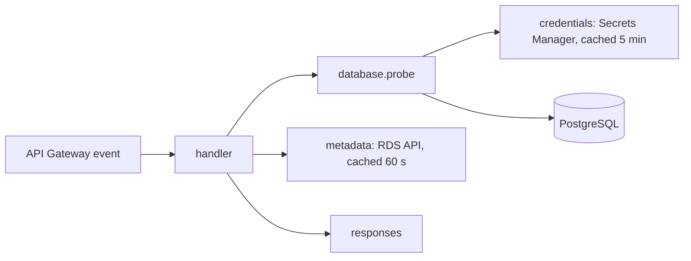

# info function

The Lambda behind `GET /info`. It connects to PostgreSQL over TLS, runs one
query and returns the connection status plus details about the database.



| Module | Does |
| ------ | ---- |
| `handler.py` | Entry point. Builds the app once, turns results into HTTP responses |
| `config.py` | Reads and validates the environment |
| `credentials.py` | Reads the database password from Secrets Manager and caches it |
| `database.py` | Opens and reuses one connection, runs the probe, maps failures to a category |
| `metadata.py` | Reads instance details from the RDS API. Best effort: failure returns `null` |
| `responses.py` | Builds the JSON bodies |

## Configuration

| Variable | Default | Meaning |
| -------- | ------- | ------- |
| `DB_HOST` | required | Database DNS name |
| `DB_NAME` | required | Database to connect to |
| `DB_PORT` | 5432 | |
| `DB_SECRET_ARN` | | Secrets Manager secret with `username` and `password`. Required unless `DB_USER` and `DB_PASSWORD` are set (local runs) |
| `DB_INSTANCE_ID` | | RDS instance identifier. Without it, `instance` is `null` |
| `DB_SSL_MODE` | `verify-full` | `verify-full` checks the certificate chain and hostname. `disable` is for a local database only |
| `DB_CONNECT_TIMEOUT_S` | 3 | Socket timeout, 1-10 |
| `DB_STATEMENT_TIMEOUT_MS` | 2000 | Server-side limit for the probe, 100-10000 |
| `LOG_LEVEL` | `INFO` | |

## Responses

`200` when the database answers:

```json
{
  "status": "ok",
  "timestamp": "2026-10-22T15:04:05Z",
  "request_id": "8f0c2c1e-0000-0000-0000-000000000000",
  "database": {
    "connected": true,
    "engine": "postgres",
    "version": "17.4",
    "database": "appdb",
    "in_recovery": false,
    "uptime_seconds": 86400,
    "tls": true,
    "latency_ms": 4.2
  },
  "instance": {
    "class": "db.t4g.micro",
    "status": "available",
    "multi_az": false,
    "availability_zone": "us-east-1a",
    "storage_type": "gp3",
    "allocated_storage_gb": 20,
    "backup_retention_days": 7
  },
  "runtime": { "region": "us-east-1", "cold_start": false }
}
```

`503` when it does not. The body carries a category and nothing else: no host,
user, or exception text. The details go to the log with the same `request_id`.

| `database.error` | Meaning |
| ---------------- | ------- |
| `timeout` | Connect or statement timeout |
| `tls` | Certificate or TLS negotiation failed |
| `authentication` | Rejected after one retry with a fresh secret |
| `credentials` | The secret could not be read |
| `unavailable` | Refused, unreachable or too many connections |

`500` means the function itself is misconfigured (`configuration`) or hit an
unexpected error (`internal`).

## Behaviour worth knowing

- **One connection per warm instance.** A stale connection (idle timeout, RDS
  failover) is replaced once; a failing fresh connection is not retried, so
  an outage costs one timeout, not two.
- **Password rotation.** RDS rotates the secret every seven days. After an
  authentication failure the cache is dropped and one retry reads the new value.
- **Secrets stay out of output.** Passwords are excluded from `repr` and never
  logged.

## Develop

```bash
make function-lint function-test   # from the repository root
make build                         # packages build/functions/info for the Lambda
```

Integration tests run against any PostgreSQL you point them at; without
`DB_HOST` they are skipped:

```bash
DB_HOST=127.0.0.1 DB_PORT=5432 DB_NAME=appdb DB_USER=app DB_PASSWORD=<password> \
DB_SSL_MODE=disable make function-integration
```

They cover the real driver and queries, the session's statement timeout,
connection reuse, a wrong password, a closed port and the handler end to end.
TLS verification against the real RDS certificate can only be exercised once
deployed; the unit tests check that the SSL context requires a valid
certificate and hostname.

The package is built from the locked dependencies with hashes, for Linux arm64
and Python 3.13. All dependencies are pure Python; `boto3` comes from the
Lambda runtime and is not bundled.

## RDS CA bundle (`src/info_api/certs/global-bundle.pem`)

`global-bundle.pem` is the public certificate bundle AWS publishes for RDS, used
to verify the database's TLS certificate (`verify-full`):

- Source: `https://truststore.pki.rds.amazonaws.com/global/global-bundle.pem`
- SHA-256: `90a6f1a7978a1b1b096dca6c57511ca48d3b8cf052f8e704baf358f34ea2f21b`
- Contents: 114 public CA certificates, no private keys.
